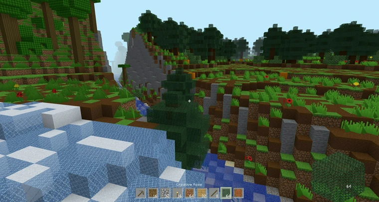

# Roots & Ridges

A procedural voxel sandbox survival game written in **Rust** with **wgpu** for modern cross-platform graphics on **Linux** and **Windows** (plus dedicated multiplayer server support).



---

## Features

- **Voxel Engine & Lighting**: $16 \times 16 \times 16$ chunked world with hidden-face culling, greedy meshing, translucent ice/water rendering, vertex ambient occlusion, and BFS flood-fill sunlight/blocklight propagation (including sky light passing through leaves).
- **20 Procedural Biomes**: Plains, Flower Meadow, Forest, Birch Forest, Dark Forest, Taiga, Snowy Tundra, Glacier, Mountains, Desert, Red Desert, Badlands, Savanna, Jungle, Swamp, Beach, Stony Shore, River, Ocean, and Coral Reef — with macro-cell minimum biome sizing, relief contrast, and atmospheric fog.
- **MMO Skills & Leveling (1–1000)**: Per-world/server progression across 7 skills (**Combat**, **Woodcutting**, **Mining**, **Fishing**, **Digging**, **Farming**, **Agility**) with gradual scaling perks and major milestone unlocks (`K` menu / `/skills`).
- **Fishing & Tackle**: Craftable Wooden, Copper, Iron, and Diamond Fishing Rods with upgradeable lines, lures, and bait, an interactive timing minigame, and 10 fish species plus treasure catches.
- **Day/Night Cycle & Beds**: Dynamic skybox with moving sun and moon, dusk-to-dawn monster spawning, and 2-block-long beds to skip the night (requires $\ge 50\%$ of players sleeping in multiplayer).
- **Survival, Creative Mode, Crafting & Smelting**:
  - Health, hunger, fall damage, drowning, and underwater visual effects, plus **Creative Mode** (world creation toggle or `/gamemode`).
  - 2x2 inventory crafting, 3x3 Crafting Table, Furnace smelting, Chests, and an integrated JEI-style recipe/usage browser (`R` / `U` on hovered items).
  - Tool durability across Wood, Stone, Iron, Gold, and Diamond tiers, plus 16-piece Armor sets (Leather, Iron, Gold, Diamond) and Bow & Arrow combat.
- **Passive & Hostile Mobs**:
  - **Passive Animals**: Cows, Pigs, Chickens, and Sheep (shearing/wool drops, plus Wheat breeding with baby scaling, heart particles, and a 5-minute cooldown).
  - **Hostile Monsters**: Zombies, Skeletons (ranged bow AI), and Spiders with light-gated spawning and animated 3D flame visuals when burning in sunlight.
- **Custom Stereo Soundtrack & Spatial Audio**: Embedded stereo MP3 soundtrack with contextual triggers (adventuring, mining, and anytime background tracks) alongside 3D spatial SFX and proximity voice chat.
- **Multiplayer & Dedicated Server**: TCP client/server architecture (`blockgame_server`) with modular world saves, player accounts, groups/ranks, permissions, and server console/in-game slash commands.

---

## Repository Structure

```text
BlockGame/
├── .github/workflows/
│   └── release.yml         # Automated Windows & Linux release builds
├── crates/
│   ├── blockgame_core/     # Voxels, chunks, AABB physics, DDA raycasting, mobs, items, net, commands
│   ├── blockgame_gen/      # Seeded terrain noise, caves, 16 biomes, trees & feature generation
│   ├── blockgame_render/   # wgpu pipelines, chunk/mob meshing, celestial sky, 32x atlas, UI
│   ├── blockgame_client/   # Desktop client (winit + wgpu + rodio audio)
│   └── blockgame_server/   # Headless dedicated multiplayer server CLI
├── docs/
│   ├── ARCHITECTURE.md     # Technical architecture blueprint
│   ├── ROADMAP.md          # Early development milestone checklist
│   └── wiki/               # Source pages for the GitHub Wiki
├── assets/                 # Shaders (WGSL), textures, audio assets
└── Cargo.toml              # Cargo workspace configuration
```

---

## Getting Started

### Option 1: Download Prebuilt Executables
Download the latest archive from the [GitHub Releases](https://github.com/Mjwitz/BlockGame/releases) page:
- **Linux (`x86_64`)**: `BlockGame-linux-x86_64.tar.gz` (`blockgame_client`, `blockgame_server`)
- **Windows (`x86_64`)**: `BlockGame-windows-x86_64.zip` (`blockgame_client.exe`, `blockgame_server.exe`)

### Option 2: Build from Source

#### Prerequisites
- [Rust toolchain](https://www.rust-lang.org/) (stable)
- Vulkan, DirectX 12, or Metal compatible GPU drivers (for `blockgame_client`)
- **Linux build dependencies** (Debian/Ubuntu):
  ```bash
  sudo apt-get update
  sudo apt-get install -y build-essential pkg-config libasound2-dev \
    libx11-dev libxi-dev libxcursor-dev libxrandr-dev libwayland-dev libxkbcommon-dev
  ```

#### Build & Run
```bash
# Build release binaries for both client and server
cargo build --release -p blockgame_client -p blockgame_server

# Run the game client
cargo run --release -p blockgame_client

# Run the dedicated multiplayer server
cargo run --release -p blockgame_server -- --port 25565 --world "MyWorld" --seed 1337
```

---

## Quick Controls

| Key / Input | Action |
| :--- | :--- |
| `W A S D` | Move |
| `Space` | Jump / Swim up / Fly up |
| `Left Ctrl` | Sprint |
| `Left Click` | Break block / Attack |
| `Right Click` | Place block / Interact (Bed, Chest, Furnace, Crafting Table) / Shoot Bow / Feed Animal |
| `1` - `9` / Scroll | Select hotbar slot |
| `E` | Open / Close Inventory |
| `R` / `U` | View Recipe / Usages for hovered item (in Inventory) |
| `T` | Open Chat / Slash Commands |
| `F` | Toggle Flight mode |
| `F5` | Toggle First-person / Third-person camera |
| `Tab` | Show online player list (Multiplayer) |
| `Esc` | Close UI / Pause Menu |

---

## Documentation

For detailed guides on gameplay, biomes, mobs, multiplayer server hosting, commands, permissions, and building releases, visit the **[BlockGame Wiki](https://github.com/Mjwitz/BlockGame/wiki)** (source files also tracked in [`docs/wiki/`](docs/wiki/Home.md)).

---

## License

Licensed under either of [Apache License 2.0](http://www.apache.org/licenses/LICENSE-2.0) or [MIT License](http://opensource.org/licenses/MIT) at your option.
