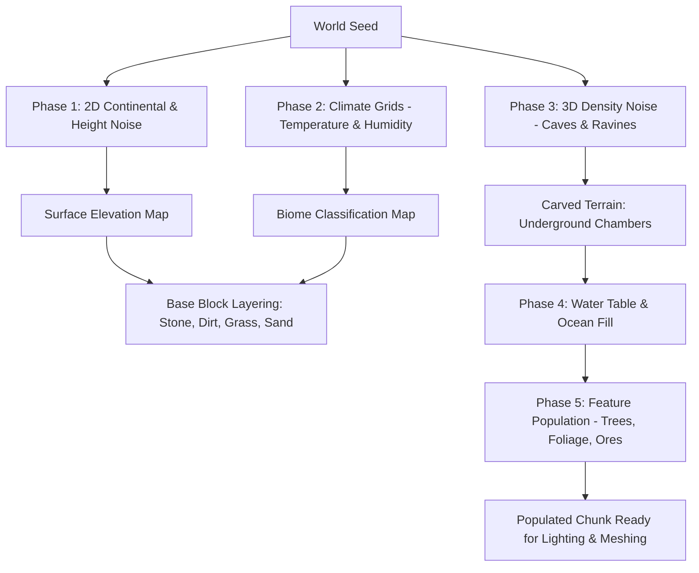

# BlockGame Technical Architecture & Design Blueprint

## 1. Executive Summary & Philosophy

**BlockGame** is a high-performance voxel sandbox game built in **Rust** using **wgpu** for rendering, targeting both **native desktop** (Vulkan, DirectX 12, Metal) and **WebAssembly** (WebGPU / WebGL2 via `wasm-bindgen`).

### Core Design Principles
1. **Voxels as Data, Not Objects**: Never instantiate meshes per block. A block is a compact numeric identifier (`u8` / `u16`) in a dense 3D array representing a chunk.
2. **Deterministic & Procedural**: The entire world state is derived from a master 64-bit seed and $(X, Y, Z)$ coordinates using procedural noise functions.
3. **Decoupled Architecture**: Game logic, world generation, and physics live in pure, platform-agnostic Rust crates with zero rendering dependencies, enabling headless simulation, automated unit tests, and multiplayer server reusability.
4. **Data-Oriented Cache-Friendly Layout**: Chunk block data, light maps, and mesh vertex streams are organized in contiguous memory to maximize L1/L2 cache locality and SIMD autovectorization.
5. **Zero-Stutter Multithreading**: Mesh building, procedural generation, and lighting propagation are scheduled asynchronously off the main render thread.

---

## 2. Workspace & Crate Structure

The repository is organized as a Cargo workspace with separation of concerns:

```text
BlockGame/
├── Cargo.toml                  # Workspace manifest
├── docs/                       # Architectural specs and roadmap
│   ├── ARCHITECTURE.md
│   └── ROADMAP.md
├── crates/
│   ├── blockgame_core/         # Pure voxel math, chunk data, block registry, AABB physics, DDA
│   │   ├── src/
│   │   │   ├── block.rs        # Block IDs, attributes, definitions
│   │   │   ├── chunk.rs        # Chunk data layout (16x16x16 or 16x256x16), indexing
│   │   │   ├── world.rs        # World coordinates, chunk storage & lookup
│   │   │   ├── physics.rs      # AABB collision resolution
│   │   │   ├── raycast.rs      # Fast voxel traversal (DDA)
│   │   │   ├── inventory.rs    # Items, slots, stack operations
│   │   │   └── crafting.rs     # Shaped/shapeless recipe matching
│   │   └── Cargo.toml
│   ├── blockgame_gen/          # World generator: 2D/3D noise, biomes, caves, structures
│   │   ├── src/
│   │   │   ├── noise.rs        # Perlin / Simplex / FBM noise wrappers
│   │   │   ├── heightmap.rs    # 2D surface terrain generation
│   │   │   ├── caves.rs        # 3D density noise & worm carving
│   │   │   ├── biomes.rs       # Temperature & humidity mapping
│   │   │   └── decorations.rs  # Cross-chunk feature distribution
│   │   └── Cargo.toml
│   ├── blockgame_render/       # wgpu rendering pipeline, meshing, shaders, texture atlas
│   │   ├── src/
│   │   │   ├── meshing/        # Face culling & greedy meshing algorithms
│   │   │   ├── lighting/       # BFS sunlight & blocklight flood-fill
│   │   │   ├── atlas.rs        # Texture atlas layout and UV coordinate mapping
│   │   │   ├── pipeline.rs     # wgpu render pipelines, bind groups, vertex buffers
│   │   │   ├── camera.rs       # View-projection matrices, frustum culling
│   │   │   └── shaders/        # WGSL voxel shaders (lighting, fog, day/night)
│   │   └── Cargo.toml
│   └── blockgame_client/       # Main executable (desktop winit app + web wasm entrypoint)
│       ├── src/
│       │   ├── main.rs         # Native desktop bootstrap
│       │   ├── lib.rs          # WebAssembly (wasm-bindgen) bootstrap
│       │   ├── app.rs          # Main game loop, input handling, tick dispatcher
│       │   └── ui.rs           # HUD, crosshair, inventory overlay
│       └── Cargo.toml
└── assets/
    ├── textures/               # Block texture PNGs
    └── shaders/                # WGSL source files
```

---

## 3. Voxel Data Representation & Chunk Engine

### 3.1. Block Representation
- **Block ID**: `u8` (supports 256 unique block types; upgradeable to `u16` if metadata or extended palettes are required).
- Block ID `0` is strictly reserved for `Air` (transparent, non-solid).
- Each block type is defined in a centralized `BlockRegistry`:
  - `is_solid: bool` (collidable by player/entities)
  - `is_transparent: bool` (allows neighboring faces to be rendered)
  - `luminance: u8` (emitted blocklight level, 0 to 15)
  - `textures: [TextureId; 6]` (individual face textures: Top, Bottom, North, South, East, West)

### 3.2. Coordinate Systems & Chunk Dimensions
- **Voxel Coordinate**: Integer world position $(X, Y, Z) \in \mathbb{Z}^3$.
- **Chunk Dimensions**: $16 \times 16 \times 16$ sub-chunks (or $16 \times 256 \times 16$ vertical columns). Using $16 \times 16 \times 16$ cubic chunks allows dynamic vertical loading, cave rendering, and efficient frustum culling.
- **Index Flattening Formula**:
  $$\text{index} = x + (z \times 16) + (y \times 256)$$
  where $x, y, z \in [0, 15]$.
- Fast bitwise indexing:
  $$\text{index} = x \mid (z \ll 4) \mid (y \ll 8)$$

### 3.3. Mesh Generation & Face Culling
1. **Hidden-Face Culling**:
   - For every non-air block at $(x, y, z)$, test all 6 cardinal neighbors $(x\pm1, y, z)$, $(x, y\pm1, z)$, $(x, y, z\pm1)$.
   - Generate a quad only if the neighboring block is transparent (or out-of-bounds in an air/unloaded chunk).
   - Boundary checks inspect adjacent neighbor chunks to ensure chunk borders cull seamless planar surfaces.
2. **Greedy Meshing**:
   - For each of the 6 directions, slice the chunk into 2D slices.
   - Group contiguous coplanar faces of identical block type and lighting into rectangular quads.
   - Reduces vertex and triangle count by $60\%\text{--}85\%$ compared to naive face culling.
3. **Vertex Data Packing**:
   Instead of bulky 32-bit float structs, pack vertex attributes into compact integers:
   - Position: $x, y, z$ (packed into a single `u32` or `[u8; 3]`).
   - Normal / Face Direction: 3-bit integer (0..5).
   - Texture Atlas Index / UV Corner: `u16` atlas offset + 2-bit corner.
   - Light (Sunlight, Blocklight, Ambient Occlusion): packed into `u16`.
   - **Total vertex size**: 8 to 12 bytes per vertex, enabling high GPU throughput.

---

## 4. Procedural World Generation

Procedural generation is executed in multiple deterministic phases:



### 4.1. Mathematical Formulas
- **Surface Elevation**:
  $$H(x, z) = H_{\text{base}} + \sum_{i=0}^{N-1} A \cdot r^i \cdot \text{Noise}_{2D}\left(f \cdot 2^i \cdot x, \; f \cdot 2^i \cdot z\right)$$
  (Fractal Brownian Motion with lacunarity 2.0 and persistence 0.5).
- **3D Cave Density**:
  $$D(x, y, z) = \text{Noise}_{3D}(x \cdot f_c, y \cdot f_c, z \cdot f_c) + \text{depth\_bias}(y)$$
  If $D(x, y, z) > T_{\text{cave}}$, block is carved to Air.
- **Biomes**:
  - Sample $T(x, z)$ (Temperature) and $M(x, z)$ (Moisture) using low-frequency noise ($f \approx 0.001$).
  - Map $(T, M)$ pair onto a 2D biome diagram: Plains, Forest, Desert, Taiga, Mountains, Oceans.

---

## 5. Player Physics & Voxel Interaction

### 5.1. AABB Swept Collision Detection
- Player bounding box: Dimensions $0.6 \times 1.8 \times 0.6$ blocks.
- Velocity integration with discrete sub-step axis separation:
  1. Move along $Y$ axis; detect collisions against solid voxel bounds $\lfloor \text{min} \rfloor$ to $\lceil \text{max} \rceil$. Resolve vertical penetration and zero vertical velocity on ground impact.
  2. Move along $X$ axis; resolve horizontal penetration.
  3. Move along $Z$ axis; resolve depth penetration.
- Step-assist: Allow automatic 0.5-block step-up onto half-slabs or 1-block steps if obstacle allows clearance.

### 5.2. Fast Voxel Traversal (Amanatides-Woo DDA Algorithm)
- Given camera origin $\vec{O}$ and direction $\vec{D}$ with reach distance $R = 5.0$ blocks:
  - Initialize voxel step directions: $\text{step}_i = \text{sign}(D_i)$.
  - Initialize $\Delta t_i = |1 / D_i|$.
  - Initialize $t_{\text{max}, i}$ to distance to nearest voxel boundary.
  - Step through voxels iteratively by advancing the axis with the minimum $t_{\text{max}}$.
  - The first solid voxel hit returns:
    - `hit_voxel`: Target block coordinate $(X, Y, Z)$.
    - `hit_face_normal`: Normal vector $\vec{N}$ of the face intersected (Top, Bottom, etc.).
- **Block Removal**: Set `world.set_block(hit_voxel, Air)`.
- **Block Placement**: Check $\text{place\_pos} = \text{hit\_voxel} + \vec{N}$ does not intersect player's AABB; set `world.set_block(place_pos, selected_block)`.
- Rebuild meshes for affected chunk and any adjacent chunk if the modified block lies on a chunk boundary ($x=0,15$, etc.).

---

## 6. Lighting & Shading Engine

Dual-channel voxel lighting model:

### 6.1. Sunlight & Blocklight Storage
- Stored as a packed 8-bit byte per block:
  - High 4 bits: `Sunlight` ($0\text{--}15$).
  - Low 4 bits: `Blocklight` ($0\text{--}15$).
- **Sunlight Propagation**:
  1. Cast vertical rays from top of world down through air blocks with intensity 15.
  2. First solid block terminates the full-strength downward ray.
  3. Run BFS queue from each sunlight column to spread sunlight laterally with attenuation ($I - 1$).
- **Blocklight Propagation**:
  - Emissive blocks (torches = 14, lava = 15) seeded into BFS queue.
  - Neighboring air blocks receive $\max(\text{current}, \text{source} - 1)$.
- **Smooth Vertex Ambient Occlusion (AO)**:
  - For each vertex of a quad, query the 3 adjacent corner/edge voxels.
  - Compute AO factor $0, 1, 2, 3$ ($0 = \text{fully occluded}, 3 = \text{fully exposed}$).
  - Interpolated across quad faces to avoid triangle seam artifacts.

### 6.2. Day/Night Cycle & WGSL Shader
- `WorldTime` ticks from $0$ to $24000$ (20-minute real-time day).
- Directional sun/moon vector computed from time:
  $$\theta = \frac{\text{WorldTime}}{24000} \times 2\pi$$
- Atmospheric fog color and skybox clear color dynamically interpolated:
  - Dawn / Sunrise: Golden orange / deep blue.
  - Noon: Sky blue / bright white light.
  - Dusk: Crimson / violet.
  - Midnight: Deep navy / silver moonlight.
- Final fragment color:
  $$\vec{C}_{\text{final}} = \vec{C}_{\text{tex}} \times \left( \max(\text{Blocklight}, \; \text{Sunlight} \times I_{\text{sun}}(\text{time})) + \text{Ambient} \right) \times \text{AO}$$

---

## 7. Inventory & Crafting Architecture

- **Data Models**:
  ```rust
  pub struct ItemSlot {
      pub item_id: u16,
      pub count: u8,
      pub durability: u16,
  }

  pub struct Inventory {
      pub hotbar: [Option<ItemSlot>; 9],
      pub main: [Option<ItemSlot>; 27],
      pub armor: [Option<ItemSlot>; 4],
  }
  ```
- **Crafting Grid Matching**:
  - Shapeless: Multiset / histogram comparison of input items versus recipe components.
  - Shaped: $2 \times 2$ (player crafting) or $3 \times 3$ (crafting bench) grid.
  - Normalize grid inputs by computing the minimal bounding box enclosing all non-empty slots, allowing corner/offset tolerance.

---

## 8. Persistence & Serialization

- **Chunk Serialization**:
  - Modified chunks are compressed using Palette Compression:
    1. Scan unique block IDs within chunk (typically $< 16$ distinct block types).
    2. Build local 4-bit palette array.
    3. Pack voxel indices into compact bitstreams.
  - Run-Length Encoding (RLE) on homogenous vertical layers.
  - Zstandard (`zstd`) compression for region file chunks (`.bgc` format).
- **Delta Storage**: Chunks identical to the procedural world generator output are discarded and regenerated on demand; only player-modified or decorated delta chunks are stored to disk.

---

## 9. WebAssembly & Native Portability

- Native: Direct window creation with `winit`, multithreaded generation using `rayon`.
- WASM: Canvas mounting, event loop bound via `web_sys` and `wasm_bindgen`, asynchronous chunk meshing via web workers or cooperative task slicing.
- Common GPU API: `wgpu` automatically routes to WebGPU when available in modern browsers, falling back gracefully to WebGL2.
